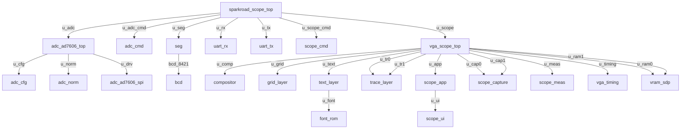

# Verilog 模块层次树

> 由 `tools/gen_hierarchy.py` 自动生成；在 VS Code 中打开本文件，
> 按 Ctrl+Shift+V 预览（安装 Markdown Preview Mermaid Support 可渲染下图）。

生成命令：python tools/gen_hierarchy.py（默认根目录 FPGA/src）。

## 1. Mermaid 层次图（从 sparkroad_scope_top 开始）



## 2. ASCII 树

```
sparkroad_scope_top  (sparkroad_scope_top.v)
  |  [u_adc]
    +-- adc_ad7606_top  (adc_ad7606_top.v)
      |  [u_cfg]
        +-- adc_cfg  (adc_cfg.v)
      |  [u_norm]
        +-- adc_norm  (adc_norm.v)
      |  [u_drv]
        +-- adc_ad7606_spi  (adc_ad7606_spi.v)
  |  [u_adc_cmd]
    +-- adc_cmd  (adc_cmd.v)
  |  [u_seg]
    +-- seg  (seg.v)
      |  [bcd_8421]
        +-- bcd  (bcd.v)
  |  [u_rx]
    +-- uart_rx  (uart_rx.v)
  |  [u_tx]
    +-- uart_tx  (uart_tx.v)
  |  [u_scope_cmd]
    +-- scope_cmd  (scope_cmd.v)
  |  [u_scope]
    +-- vga_scope_top  (vga_scope_top.v)
      |  [u_comp]
        +-- compositor  (compositor.v)
      |  [u_grid]
        +-- grid_layer  (grid_layer.v)
      |  [u_text]
        +-- text_layer  (text_layer.v)
          |  [u_font]
            +-- font_rom  (font_rom.v)
      |  [u_tr0]
        +-- trace_layer  (trace_layer.v)
      |  [u_tr1]
        +-- trace_layer  (trace_layer.v)
      |  [u_app]
        +-- scope_app  (scope_app.v)
          |  [u_ui]
            +-- scope_ui  (scope_ui.v)
      |  [u_cap0]
        +-- scope_capture  (scope_capture.v)
      |  [u_cap1]
        +-- scope_capture  (scope_capture.v)
      |  [u_meas]
        +-- scope_meas  (scope_meas.v)
      |  [u_timing]
        +-- vga_timing  (vga_timing.v)
      |  [u_ram0]
        +-- vram_sdp  (vram_sdp.v)
      |  [u_ram1]
        +-- vram_sdp  (vram_sdp.v)
```

## 3. 模块清单

| 模块 | 文件 | 例化父模块 | 子模块数 |
|---|---|---|---|
| Gowin_PLL | src/gowin_pll/gowin_pll.v | - | 0 |
| adc_ad7606_spi | src/adc/hal/adc_ad7606_spi.v | adc_ad7606_top | 0 |
| adc_ad7606_top | src/adc/adc_ad7606_top.v | sparkroad_scope_top | 3 |
| adc_cfg | src/adc/abs/adc_cfg.v | adc_ad7606_top, adc_top | 0 |
| adc_cmd | src/adc/app/adc_cmd.v | sparkroad_scope_top | 0 |
| adc_norm | src/adc/abs/adc_norm.v | adc_ad7606_top, adc_top | 0 |
| adc_par | src/adc/hal/adc_par.v | adc_top | 0 |
| adc_spi | src/adc/hal/adc_spi.v | adc_top | 0 |
| adc_stub | src/adc/hal/adc_stub.v | adc_top | 0 |
| adc_top | src/adc/adc_top.v | adda_scope_top | 5 |
| adda | src/adda.v | adda_scope_top | 7 |
| adda_scope_top | src/vga/adda_scope_top.v | - | 6 |
| bcd | src/bcd.v | seg | 0 |
| compositor | src/vga/abs/compositor.v | vga_scope_top | 0 |
| divider | src/divider.v | adda | 0 |
| eso | src/eso.v | adda | 0 |
| fifo_top | src/fifo_top/fifo_top.v | - | 0 |
| font_rom | src/vga/hal/font_rom.v | text_layer, vga_test_app | 0 |
| grid_layer | src/vga/abs/grid_layer.v | vga_scope_top | 0 |
| key | src/key.v | adda | 0 |
| rtl | src/rtl.v | adda | 0 |
| scope_app | src/vga/app/scope_app.v | vga_scope_top | 1 |
| scope_capture | src/vga/app/scope_capture.v | vga_scope_top | 0 |
| scope_cmd | src/vga/app/scope_cmd.v | adda_scope_top, sparkroad_scope_top | 0 |
| scope_meas | src/vga/app/scope_meas.v | vga_scope_top | 0 |
| scope_ui | src/vga/app/scope_ui.v | scope_app, vga_test_top | 0 |
| seg | src/seg.v | adda, sparkroad_scope_top | 1 |
| sparkroad_scope_top | src/sparkroad_scope_top.v | - | 7 |
| text_layer | src/vga/abs/text_layer.v | vga_scope_top | 1 |
| trace_layer | src/vga/abs/trace_layer.v | vga_scope_top | 0 |
| uart_rx | src/uart_rx.v | adda, adda_scope_top, sparkroad_scope_top | 0 |
| uart_tx | src/uart_tx.v | adda, sparkroad_scope_top | 0 |
| vga_scope_top | src/vga/vga_scope_top.v | adda_scope_top, sparkroad_scope_top | 12 |
| vga_test_app | src/vga/app/vga_test_app.v | vga_test_top | 1 |
| vga_test_top | src/vga/vga_test_top.v | adda_scope_top | 3 |
| vga_timing | src/vga/hal/vga_timing.v | vga_scope_top, vga_test_top | 0 |
| vram_sdp | src/vga/hal/vram_sdp.v | vga_scope_top | 0 |

