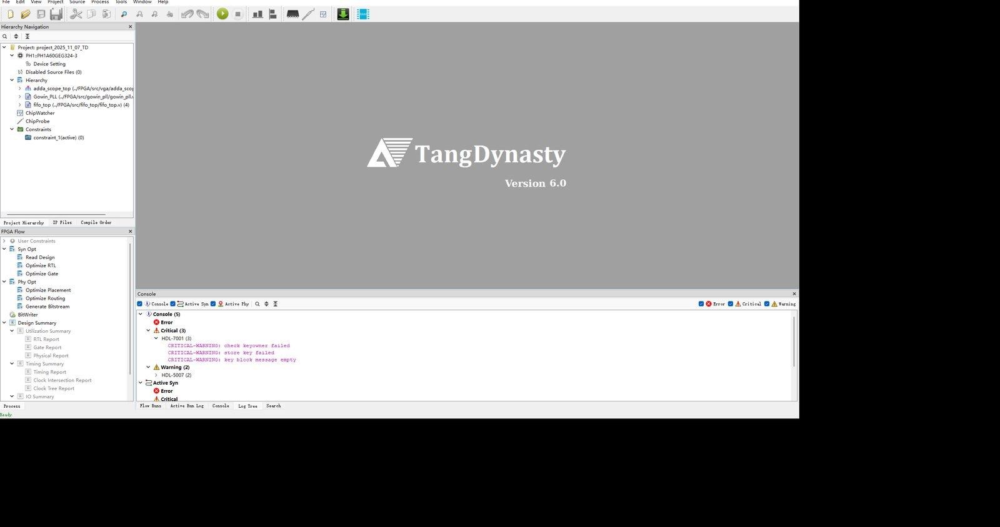

# FPGA 工程 project_2025_11_07 —— 代码注释与逐层解析交付物

本目录针对 `C:\Users\Administrator\Desktop\task\FPGA` 下的高云（Gowin）工程做了三件事：
用安路 TD 打开浏览、给全部源码逐块加注释、把解析写成 LaTeX 文档并编译成 PDF。

**代码仓库**：<https://github.com/starfruitsz/FPGA>

---

## 1. 交付物清单

| 交付物 | 路径 | 说明 |
|---|---|---|
| TD 容器工程 | `FPGA_TD/project_2025_11_07_TD.al` | 用 TD 6.0.3 打开，引用原始源码（不复制） |
| TD 工程文件列表 | `FPGA_TD/files.list` | `add_files -list` 用的清单 |
| 建立工程脚本 | `FPGA_TD/make_prj.tcl` | 可重复执行，重建容器工程 |
| 注释后源码 | `FPGA/src/**` | 17 个文件，仅新增 `//` 注释 |
| 原始源码备份 | `FPGA/src_original_backup/**` | 注释前的逐字节副本 |
| LaTeX 文档 | `doc/main.tex` + `doc/ch*.tex` + `doc/appendix.tex` | 19 章（ch01–ch19）+ main/style/appendix |
| 最终 PDF | `FPGA_project_analysis.pdf`（131 页） | 与 `doc/main.pdf` 相同；第 17–19 章：修复记录 / 示波器 v2 / SparkRoad 移植 |
| TD 打开截图 | `TD_open_project.jpg` | 层次树已识别 adda(7)/Gowin_PLL(1)/fifo_top(4) |
| **VGA 示波器（分层）** | `FPGA/src/vga/**` | HAL/抽象/应用三层，引脚表与时基可配 |
| VGA 屏幕预览 | `FPGA/src/vga/preview_640x480.png` | 用 Python 复现渲染结果的效果图 |
| VGA 验证工程 | `FPGA_TD/scope/scope_check.al` | TD 前端分析 21 个源文件通过 |

---

---

## 1.1 VGA 示波器（分层 + 4 个特性开关）

见 [FPGA/src/vga/README.md](FPGA/src/vga/README.md)。要点：

- **分层**：HAL（vga_timing / vram_sdp / font_rom）→ 抽象（grid / trace / text / compositor）
  → 应用（scope_app / scope_capture / scope_meas / scope_cmd / scope_ui）→ 顶层
  （vga_scope_top / adda_scope_top）；
- **IO 列表可配置**：改 `FPGA/src/vga/pins/scope_pins.csv` 后运行
  `python gen_cst.py` 生成 `.cst`，RTL 里不含任何引脚信息；
- **时基可配置**：8 档预设（1k~50M S/s）+ 按键（短按切档/长按冻结）+ 串口在线改；
- **4 个特性可开关**（`adda_scope_top.v` 顶部 4 个 localparam，改一行即可）：
  | 开关 | 特性 | 说明 |
  |---|---|---|
  | FEAT_TRIG | ① 触发对齐 | 电平穿越时写指针归零，波形不漂 |
  | FEAT_MEAS | ② 自动测量 | 帧内峰峰值/频率，显示在文本第 2 行 |
  | FEAT_SCROLL | ③ 滚动显示 | 最新采样恒在最右列 |
  | FEAT_UART | ④ 串口配置 | ASCII 命令 T/R/A/L/E/S（独立第二路 uart_rx） |
- **屏幕自检**：`TEST_MODE=1`（或把 Top 设为 `vga_test_top`）即输出 5 幅自检画面
  （彩条/灰阶/棋盘/边框+移动方块/文字），用来单独判断屏幕与接线，与示波器完全解耦；
- **初学者级注释**：VGA 子系统 16 个源文件均按“文件导读 → 每个 always/assign 块 → 块内每条语句”注释，
  含概念解释（为什么用 pix_ce 而不是分频时钟、BSRAM 为什么晚一拍、同步信号为什么要延迟 2 拍等）；
- **无帧缓存**：只在像素列上做 "y 映射 + 相邻点竖线连接"，2 块 BSRAM、约 1.7K LUT；
- **验证**：TD 6.0.3 前端分析 23 个文件通过；自写端口检查 26 处例化 0 错误；
  渲染数学用 Python 复现并出图（`preview_640x480.png`）。


**工程接入状态**：14 个 VGA 源文件已加入 Gowin 工程
（`FPGA/project_2025_11_07.gprj` 的 FileList 由 12 条变为 26 条）；
TD 容器工程 `FPGA_TD/project_2025_11_07_TD.al` 已收录 25 个源文件、
Top 设为 `adda_scope_top`，并已重新打开验证（层次树顶层为 adda_scope_top，4 个子模块）。
Top 已在综合工程设置中改为 `adda_scope_top`（`impl/gwsynthesis/*.prj` 的
`top_module` 与 `process_config.json` 的 `TopModule`）；VGA 的 8 个引脚已从 PnR 报告的
**All Package Pins** 中选出 bank 4 的空闲 IO（T11/T12/U13/R10/U11/N12/V14/M11，全部 3.3V、
与现有 30 个端口及数码管自动布局引脚无冲突），并写入 `FPGA/src/project_2025_11_07.cst`。



## 1.2 ADC 硬件抽象层与 EG4 工程（新增）

- `src/adc/`：HAL（stub/并行/SPI/AD7606 模板）+ ABS（归一化/CSR）+ 工厂 `adc_top`；
- 应用层只认 `s_data / s_ch / s_valid / s_ready`，换型号只改 `IMPL` 与 `hal/` 下驱动；
- 量程、过采样、SCLK、采样率均可通过 CSR/串口在线配置（`adc_cmd`：R/O/S/K/N）；
- `FPGA_TD/EG4S20BG256_scope.al`：按 **EG4S20BG256** 预制的 TD 工程（37 个文件、顶层 `sparkroad_scope_top`）；
- `FPGA_TD/EG4S20BG256_scope.al`：按 **EG4S20BG256** 预制的 TD 工程（37 个文件、顶层 `sparkroad_scope_top`）；
  已安装 **TD 5.6.5 SP5**（`C:\Anlogic\TD_5.6.5_SP5_170.155`，含 `arch/eagle_20.db`），
  新工程 `FPGA_TD/scope_eg4.al` 可打开并分析 35 个文件；综合需 `license/Anlogic.lic`（本机 MAC `40-A5-EF-5E-1D-40`），仍在申请。

## 1.3 SparkRoad-V（EG4S20BG256）移植（新增）

- 新顶层 `src/sparkroad_scope_top.v`：24MHz 时钟、VGA 24bit + `vga_clk`、AD7606(SPI) → CH0；
- 引脚由 `src/adc/pins/board_pins.csv` 经 `tools/gen_adc_pins.py` 生成 `FPGA_TD/eg4/SparkRoad.adc`（51 引脚）；
- **已按《SparkRoad 开发套件用户手册（全）》3.1.1 核对引脚**，修正三处：
  1. 数码管为**共阳**（段低有效、位高有效），顶层对 `seg/sel` 取反；
  2. **VGA_R 顺序**按手册 R0..R7 = K6,K3,K5,L4,M1,M2,L3,L5（官方 demo 约束顺序相反，若红色异常反转一行 CSV）；
  3. 板载 **AD1..AD7** 是 12-bit SAR ADC 的**模拟专用引脚**，不能当数字 IO；外接 AD7606 用树莓派排针；
- AD7606 接线（FPGA 引脚 / 40Pin 物理排针）：CA+CB=A7/3、BUSY=A8/5、CS=A10/7、SCLK=A9/8、
  DOUTA=A5/10、RST=A6/11、SER=3.3V/1 或 17；
- 报告第 19 章含：顶层结构、时钟/VGA、约束生成、TD 工程操作、**上板步骤、引脚教程、参数教程、故障排查、手册核对**。

## 2. 三步任务完成情况

### 2.1 用 TD 打开工程

高云 `.gprj` 是私有工程格式，**安路 TD 没有能力直接打开**；本机 TD 6.0.3 PHX SP2
的器件库（`D:\FPGA\arch\device_resource\device_resource.csv`）只有 PH1/PH2 两个 Phoenix 系列，
连 GW5A 都不存在。因此采用“同名容器工程”方案：

```tcl
cd C:/Users/Administrator/Desktop/task/FPGA_TD
create_project -family ph1 -device PH1A60GEG324 project_2025_11_07_TD .
import_device ph1_60.db -package PH1A60GEG324
add_files -list ./files.list
exit
```

器件选 `PH1A60GEG324-3`（TD 6.0.3 中与 324 球封装最接近、规模最小的一档）。
容器工程只用于**浏览/交叉引用代码**，不能用于综合本设计。

### 2.2 注释

- 覆盖：11 个工程源文件 + 2 个 IP 文件 + 2 个 IP 例化模板 + 1 个物理约束文件，共 **17 个**；
- 规模：1 765 行 → 2 515 行，新增 **750 行**注释；
- 原则：**只加注释，不改代码**。脚本比对“去掉注释后的词法内容”与备份完全一致（17/17 通过）；
- `fifo_top.v` 的主体是 Gowin 加密 IP（IEEE 1735：RSA 密钥块 + AES-128-CFB 数据块），
  只能在密文块之外加注释，**没有改动任何密文字节**；
- 复核：把注释后的工程重新交给 TD 分析，输出 `PRJ-1401 : Successfully analyzed 11 source files`，
  仅有 `BAUD_CNT_MAX becomes localparam` 与加密 IP 密钥的预期告警，**无语法错误**。

### 2.3 LaTeX 文档

`doc/main.pdf` 共 96 页，结构：

1. 工程总览（器件/工具/目录/模块树/数据流/时钟/参数）
2–13. 每个文件一章：文件信息 → 端口表 → 参数表 → 内部信号表 → **逐语句块解析**（代码片段+逐信号说明+数值推演）→ 完整注释源码
14. 设计审查：12 条缺陷清单 + 重点问题详解 + 改进建议 + 上板验证清单
附录 A–D：文件统计、信号速查、复现步骤、术语表

---

## 3. 主要发现（详见文档第 14 章）

| 编号 | 位置 | 问题 |
|---|---|---|
| P1 | adda.v / eso.v | `c_flag`/`k_flag` 置 1 后不清零 + ESO 参数更新为 if/else-if → 收到过 A 帧后 **k 参数永久失效** |
| P2 | eso.v | `sgn` 赋值 `4'b1111` 补零后是 **+15 而不是 −1** |
| P3 | eso.v | `she` 33bit 不足以容纳 32+22bit 的和 |
| P4 | bcd.v | 3 位 BCD 只能表示 0~999，AD 码 ≥1000 显示回绕（1023→023） |
| P5 | adda.v | `pi_flag` 是死逻辑；`uart_tx.pi_flag` 恒为 1，串口满载连续发送 |
| P6/P7 | seg.v | 6bit→4bit 位选截断做消隐；`point[cnt_sel]` 越界索引 |
| P8 | divider.v | 寄存器输出当钟用；注释“500 分频”与实际 50000 不符 |
| P9–P12 | 多处 | 未用端口、`initial` 初始化、12 个数码管引脚未约束、未例化 IP 仍在工程 |

另外：综合后 PLL 占用 0/6、BSRAM 0%，证明 `gowin_pll.v` 与 `fifo_top.v` 未进入网表。

---

## 4. 复现

```powershell
# 1) 重建 TD 容器工程（可选）
Get-Content .\FPGA_TD\make_prj.tcl | & 'D:\FPGA\bin\td_commands_prompt.exe' -nogui

# 2) 打开 TD 图形界面
Start-Process 'D:\FPGA\bin\td.exe' '"C:\Users\Administrator\Desktop\task\FPGA_TD\project_2025_11_07_TD.al"'

# 3) 编译文档
cd doc
xelatex main.tex
xelatex main.tex
```